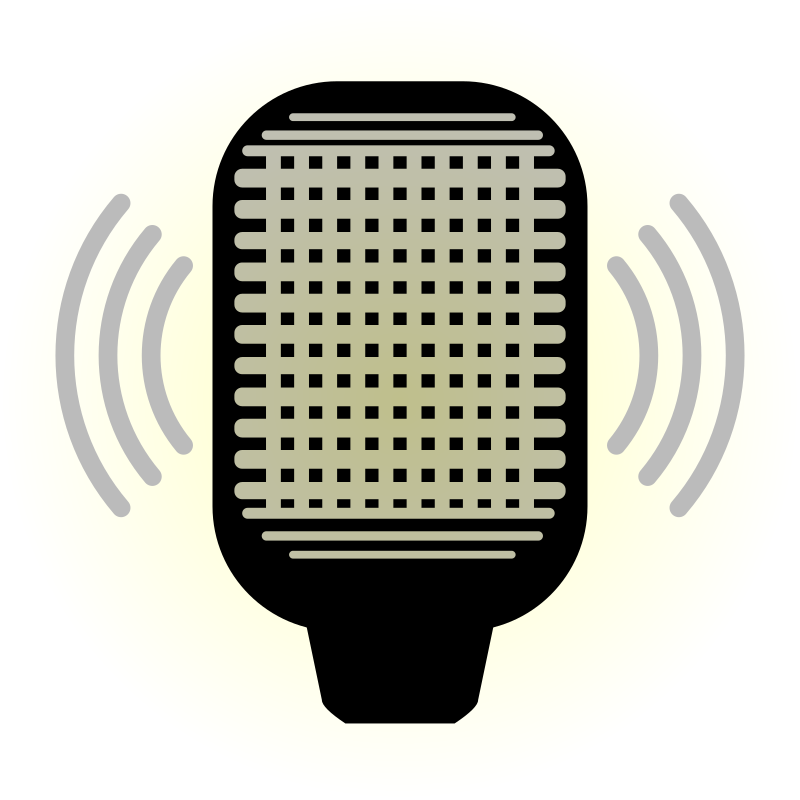

<p align="center">
  
</p>

<p align="center">
  
</p>

**Fully local, cross-platform dictation tool.**  
Speak, and your words appear where you need them — no cloud, no API keys, no AI agent services.

Gladys runs entirely on your machine using [sherpa-onnx](https://github.com/k2-fsa/sherpa-onnx) for speech-to-text and [llama.cpp](https://github.com/ggml-org/llama.cpp) for local transcription formatting. It works on **Windows** and **Linux** (Vulkan GPU support, any vendor). **macOS** is in progress.

---

## Supported platforms

| Platform | Architecture | Build host |
|---|---|---|
| Linux | x64 | Linux x86_64 |
| Windows | x64 | Windows x86_64 |
| macOS | arm64 | Apple Silicon (Intel host can build, cannot run) |

---

## Features

| Feature | Description |
|---|---|
| 100% local | No remote API calls, no data leaves your machine |
| Direct paste | Text is copied and pasted into the focused input (chat, search, editors) |
| Global hotkey | Toggles recording on/off from any application |
| Microphone selection | Choose the capture device in Settings |
| Dictionary | Word replacements applied during formatting (e.g. `gladys` → `Gladys`) |
| Style options | Markdown mode, allow accents, allow punctuation |

---

## How it works

```txt
 ┌──────────┐  hotkey  ┌───────────────┐  final text  ┌──────────────────┐
 │ Hotkey   │ ───────► │ STT           │ ───────────► │ LLM (llama-server)│
 │ toggle   │          │ miniaudio +   │              │ 127.0.0.1:8080   │
 └──────────┘          │ sherpa-onnx   │              └────────┬─────────┘
                       └───────┬───────┘                       │ formatted text
                               │ audio levels                  ▼
                       ┌───────▼───────┐              ┌──────────────────┐
                       │ Mic overlay   │              │ Paste            │
                       │ (wave bars)   │              │ copy + Ctrl+Shift+V
                       └───────────────┘              └──────────────────┘
```

1. Press the hotkey — the mic overlay opens and audio is captured.
2. Speech is buffered while recording and transcribed by sherpa-onnx on stop.
3. On stop, the raw text is sent to the local `llama-server` for formatting (casing, punctuation, dictionary).
4. The result is copied to the clipboard and pasted with `Ctrl+Shift+V` (plain text).

If the LLM fails, the raw transcription is pasted, so no dictation is lost.

---

## Hotkeys

| Platform | Toggle recording | Backend |
|---|---|---|
| Linux | `Ctrl+Alt+P` | X11 `XGrabKey` |
| Windows | `Ctrl+Alt+P` | `SetWindowsHookEx` (low-level keyboard) |
| macOS | `Ctrl+Option+P` | `CGEventTap` |

---

## Platform notes

| Platform | Clipboard | Paste backend | Extra setup |
|---|---|---|---|
| Linux | `wl-copy` | `/dev/uinput` virtual keyboard | `wl-clipboard`, uinput access |
| Windows | Qt clipboard | `SendInput` | None |
| macOS | Qt clipboard | `CGEvent` | Accessibility permission |

---

## Dependencies

- [Qt 6.8+](https://www.qt.io/) — Core, Gui, Widgets, Network, Svg
- [sherpa-onnx](https://github.com/k2-fsa/sherpa-onnx) — speech-to-text (bundled libs in `src/include/sherpa-onnx`)
- [llama.cpp](https://github.com/ggml-org/llama.cpp) — local `llama-server` (fetched by script)
- [miniaudio](https://miniaud.io/) — audio capture (single header, bundled)
- [Vulkan](https://www.vulkan.org/) — GPU acceleration for llama.cpp (optional, recommended)
- X11 development headers (Linux)
- `wl-clipboard` (Linux runtime)

---

## Models

| Component | Model | Purpose |
|---|---|---|
| STT | `sherpa-onnx-nemo-parakeet-tdt-0.6b-v3-int8` | Multilingual offline speech recognition |
| LLM | `Llama-3.2-1B-Instruct-Q4_K_M.gguf` | Transcription formatting |

---

## Build from source

### Prerequisites

| Tool | Version |
|---|---|
| CMake | 3.21+ |
| C++ compiler | C++17 |
| Qt | 6.8+ |

Install Qt with [aqt](https://github.com/miurahr/aqtinstall) (requires `pip install aqtinstall`):

```bash
scripts/qt-install.sh linux     # or: windows / macos
```

Installs into the build space and prints the `QT_ROOT_DIR` export line.

Linux only:

```bash
# Debian/Ubuntu
sudo apt install libx11-dev wl-clipboard
```

### Build

```bash
git clone https://github.com/mjesbar/gladys.git
cd gladys

export QT_ROOT_DIR=$HOME/gladys/qt-6.8.3/gcc_64
scripts/fetch-deps.sh
scripts/build.sh
```

Build space (default `$HOME/gladys`, override with `GLADYS_SPACE`):

```txt
$GLADYS_SPACE/
├── build/      CMake binary dir
├── dist/       runtime deps + app
├── release/    packaged archives
└── qt-6.8.3/   Qt install (QT_ROOT_DIR)
```

### Run

```bash
$HOME/gladys/dist/gladys
```

### Linux: enable paste (uinput)

```bash
scripts/linux/uinput.sh allow   # asks for root via pkexec
# log out and back in
scripts/linux/uinput.sh deny    # revoke
```

### Package

```bash
# Set QT_ROOT_DIR, then:
scripts/package.sh linux x64 1.0.0   # or: windows x64 / macos arm64 1.0.0
```

Artifacts land in `$GLADYS_SPACE/release/`.

---

## Usage

```txt
 Tray icon ──► Right-click ──► Settings
                              ├── Input source (microphone)
                              ├── Dictionary (from → to)
                              └── Style: markdown / accents / punctuation
```

1. Launch Gladys — a splash screen loads the models, then the tray icon appears.
2. Press `Ctrl+Alt+P` (`Ctrl+Option+P` on macOS) to start recording.
3. Speak; the overlay shows live audio levels.
4. Press the hotkey again to stop. The formatted text is pasted automatically.

---

## Project structure

```txt
gladys/
├── CMakeLists.txt
├── CMakePresets.json
├── dist/                    # runtime deps (fetch-deps.sh); build output is in the build space
├── scripts/
│   ├── build.sh
│   ├── fetch-deps.sh
│   ├── package.sh
│   ├── qt-install.sh
│   ├── linux/uinput.sh
│   ├── macos/README.md
│   └── windows/README.md
└── src/
    ├── main.cc              # entry point, wires modules, shutdown
    ├── assets/              # fonts, icons, QSS theme
    ├── include/             # miniaudio, sherpa-onnx headers + libs
    └── modules/
        ├── ai/              # stt (sherpa-onnx), llm (llama-server)
        ├── key/             # toggle (hotkey), paste (keystrokes)
        ├── log/             # per-module Qt logging categories
        ├── setting/         # persistent preferences (QSettings)
        └── ui/              # app_window, mic, splash, setting_window
```

---

## License

[GNU General Public License v3.0](LICENSE)

---

## Acknowledgements

- [llama.cpp](https://github.com/ggml-org/llama.cpp) — local LLM inference
- [sherpa-onnx](https://github.com/k2-fsa/sherpa-onnx) — speech-to-text engine
- [miniaudio](https://miniaud.io/) — audio capture library

---

## Contributing

Contributions, issues, and feature requests are welcome.  
Open an [issue](https://github.com/mjesbar/gladys/issues) or submit a pull request.
