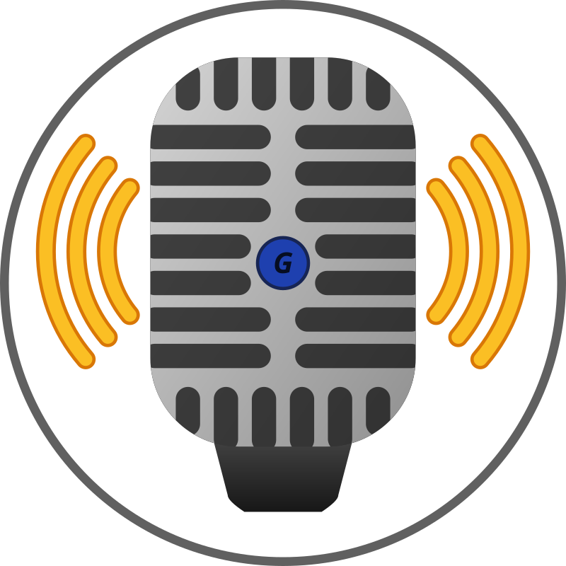
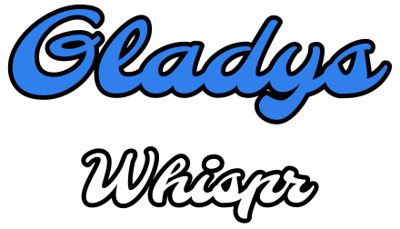
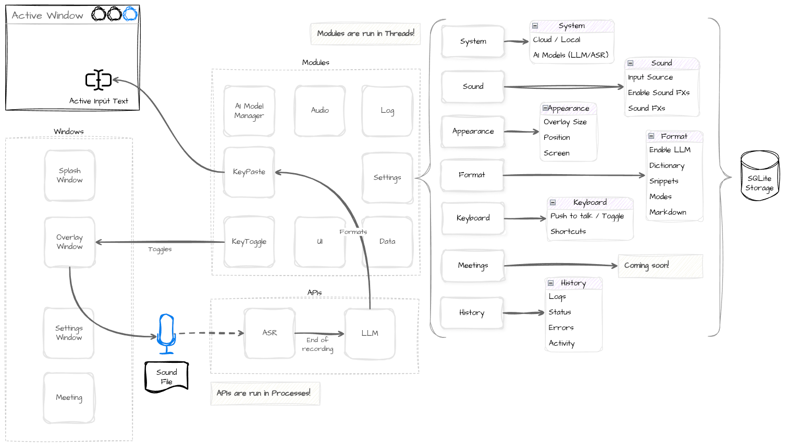

<p align="center">
  
</p>

<p align="center">
  
</p>

<p align="center">
  
  
  
  
</p>

**Fully local, cross-platform dictation tool.**  
Speak, and your words appear where you need them — no cloud, no API keys, no AI agent services.

Gladys runs entirely on your machine using [sherpa-onnx](https://github.com/k2-fsa/sherpa-onnx) for speech-to-text and [llama.cpp](https://github.com/ggml-org/llama.cpp) for local transcription formatting. It runs on **Windows**, **Linux** and **macOS** (Vulkan GPU support on Windows and Linux, any vendor).

---

# Product

### Features

| Feature              | Description                                                                          |
| -------------------- | ------------------------------------------------------------------------------------ |
| 100% local           | No remote API calls, no data leaves your machine                                     |
| Direct paste         | Text is copied and pasted into the focused input                                     |
| Global hotkey        | Toggle or Hold to record from any application. Profiles: `Ctrl+Alt+P`, `Fn`, `AltGr` |
| Microphone selection | Choose the capture device in Settings                                                |
| Dictionary           | Word replacements applied during formatting (e.g. `gladys` → `Gladys`)               |
| Style options        | Markdown mode, allow accents, allow punctuation                                      |

---

### Architecture



---

### Usage

```txt
 Settings
 ├── System      Store transcriptions
 ├── Sound       Input source (microphone), sound effects
 ├── Appearance  Theme, overlay size, position
 ├── Format      Dictionary, snippets, modes, enable LLM
 ├── Keyboard    Push to talk / toggle, shortcuts
 └── History     Logs, status, errors, activity
```

1. Launch Gladys — a splash screen loads, then the tray icon appears.
2. Press the hotkey (default `Ctrl+Alt+P`) to start recording.
3. Speak; the overlay shows live audio levels.
4. Press the hotkey again to stop. The formatted text is pasted automatically.

---

### Platform Security Notes

Gladys listens to global keystrokes to detect the hotkey and injects keystrokes to paste. Both behaviours are similar to a keylogger, so this table lists exactly what is used under the hood.

| Platform | Hotkey capture (keystrokes in)        | Paste injection (keystrokes out) | Clipboard                | Permissions                   |
| -------- | ------------------------------------- | -------------------------------- | ------------------------ | ----------------------------- |
| Linux    | evdev, reads `/dev/input/event*`      | `/dev/uinput` virtual keyboard   | `wl-copy` (wl-clipboard) | uinput access, `wl-clipboard` |
| Windows  | `SetWindowsHookEx` (`WH_KEYBOARD_LL`) | `SendInput`                      | Qt `QClipboard`          | Run as Administrator          |
| macOS    | `CGEventTap`                          | `CGEvent`                        | Qt `QClipboard`          | Accessibility permission      |

- Audio is captured with [miniaudio](https://miniaud.io/) and transcribed locally. Nothing is sent over the network.
- Transcription history is stored in plaintext in a local SQLite database (`history.db`).
- Keystrokes are only used for the hotkey and the paste shortcut. Keystroke content is not logged.

---

# Build

### Prerequisites

| Tool         | Version |
| ------------ | ------- |
| CMake        | 3.21+   |
| C++ compiler | C++17   |
| Qt           | 6.8+    |

#### 1. Install aqtinstall

```bash
pip install aqtinstall
```

#### 2. Install Qt

```bash
scripts/qt-install.sh                                    # host OS/arch (default)
scripts/qt-install.sh --os linux --arch x64              # --os: linux | macos | windows
                                                         # --arch: x64 | arm64
```

Installs into the build space and prints the `QT_ROOT_DIR` export line.

#### 3. Install Linux packages (Linux only)

```bash
# Debian/Ubuntu
sudo apt install libx11-dev wl-clipboard
```

---

### Build from source

#### 1. Set QT_ROOT_DIR

```bash
export QT_ROOT_DIR=$HOME/gladys/qt-6.8.3/gcc_64         # Linux
export QT_ROOT_DIR=$HOME/gladys/qt-6.8.3/macos          # macOS
export QT_ROOT_DIR=$HOME/gladys/qt-6.8.3/msvc2022_64    # Windows (Git Bash)
```

#### 2. Clone, fetch dependencies and build

```bash
git clone https://github.com/mjesbar/gladys.git
cd gladys

                                                        # --arch: x64 | arm64

scripts/build.sh                                        # host OS/arch (default)
scripts/build.sh --os linux --arch x64 --ma-debug off   # --ma-debug: on | off (miniaudio debug output)
```

Build space (default `$HOME/gladys`, override with `GLADYS_SPACE`):

```txt
$GLADYS_SPACE/
├── build/      CMake binary dir
├── dist/       runtime deps + app
├── release/    packaged archives
└── qt-6.8.3/   Qt install (QT_ROOT_DIR)
```

#### 3. Run

```bash
$HOME/gladys/dist/gladys
```

#### 4. Package

```bash
scripts/package.sh --version 1.0.0                      # host OS/arch (default)
scripts/package.sh --os linux --arch x64 --version 1.0.0  # --os: linux | macos | windows
                                                        # --arch: x64 | arm64
                                                        # --version: release version (required)
```

Artifacts land in `$GLADYS_SPACE/release/`.

> [!WARNING]
> **Linux: enable paste (uinput)**
>
> ```bash
> scripts/linux/uinput.sh allow   # allow: grant /dev/uinput access (asks for root via pkexec)
> # log out and back in
> scripts/linux/uinput.sh deny    # deny: revoke /dev/uinput access
> ```

---

### Dependencies

- [Qt 6.8+](https://www.qt.io/) — Core, Gui, Qml, Quick, QuickControls2, Widgets, Network, Svg, HttpServer, Sql
- [sherpa-onnx](https://github.com/k2-fsa/sherpa-onnx) — speech-to-text, bundled libs in `src/include/sherpa-onnx`
- [miniaudio](https://miniaud.io/) — audio capture (single header, bundled in `src/include/miniaudio`)
- [Vulkan](https://www.vulkan.org/) — GPU acceleration for llama.cpp on Windows and Linux (optional, recommended)
- X11 development headers (Linux build)
- `wl-clipboard` (Linux runtime)

---

### Project structure

```txt
gladys/
├── CMakeLists.txt
├── CMakePresets.json
├── scripts/
│   ├── build.sh
│   ├── package.sh
│   ├── qt-install.sh
│   ├── linux/uinput.sh
│   ├── macos/README.md
│   └── windows/README.md
└── src/
    ├── main.cc              # entry point, wires modules, shutdown
    ├── core.cc/.hpp         # pipeline: hotkey -> ASR -> LLM -> clipboard -> paste
    ├── assets/              # fonts, icons, keyboard, overlay, sfx, QSS/QML theme
    ├── include/             # miniaudio, sherpa-onnx headers + libs
    ├── apis/
    │   ├── asr/             # gladys-asr process: stt (sherpa-onnx), HTTP server
    │   ├── llm/             # llama-server launch, prompt, chat request
    │   └── server.hpp       # ports and endpoints
    ├── modules/
    │   ├── audio/           # levels, sfx
    │   ├── data/            # SQLite owner (history.db)
    │   ├── keypaste/        # paste: uinput / CGEvent / SendInput
    │   ├── keytoggle/       # toggle: evdev / CGEventTap / SetWindowsHookEx
    │   ├── log/             # per-module Qt logging categories
    │   ├── settings/        # persistent preferences per menu
    │   └── ui/              # tray, overlay, settings window, history, waves
    └── qml/
        ├── Theme.qml
        ├── components/      # ui/ kit, settings/ pages, mic widgets
        └── windows/         # Overlay, Splash, Settings, StorageError
```

---

# License

[PolyForm Shield License 1.0.0](LICENSE)

---

# Acknowledgements

- [llama.cpp](https://github.com/ggml-org/llama.cpp) — local LLM inference
- [sherpa-onnx](https://github.com/k2-fsa/sherpa-onnx) — speech-to-text engine
- [miniaudio](https://miniaud.io/) — audio capture library
- [Kompute](https://github.com/KomputeProject/kompute) — Vulkan compute

---

# Contributing

Contributions, issues, and feature requests are welcome.  
Open an [issue](https://github.com/mjesbar/gladys/issues) or submit a pull request.
